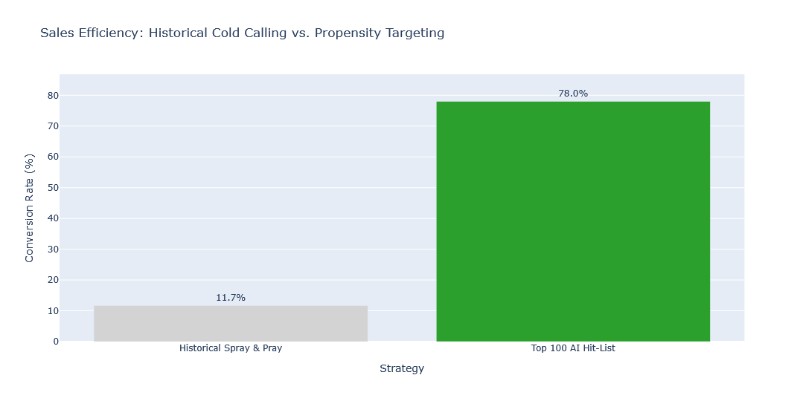
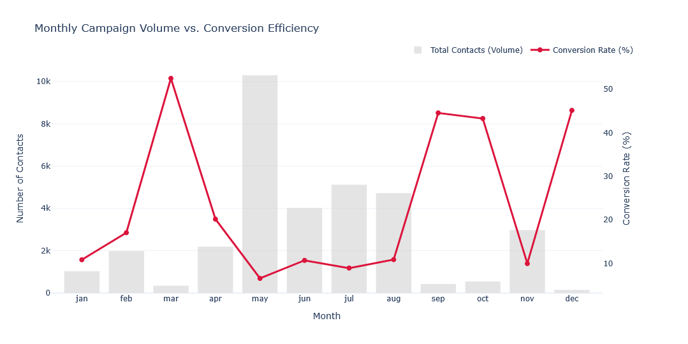
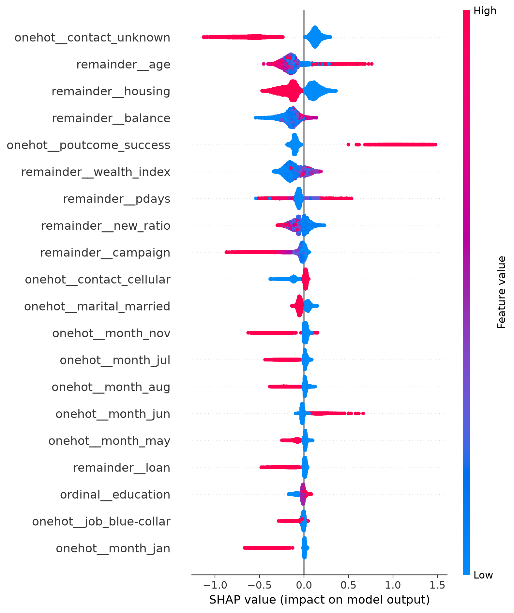
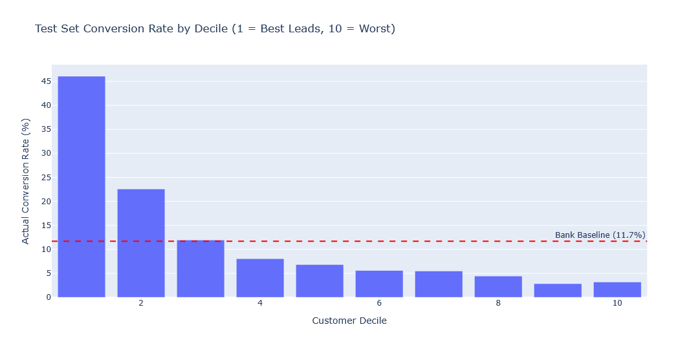
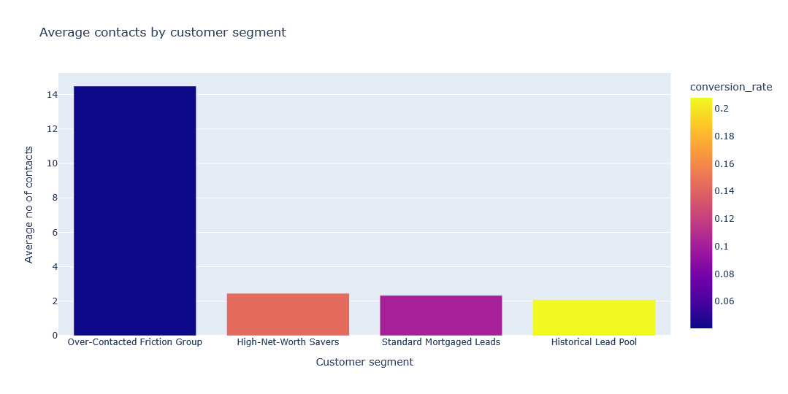
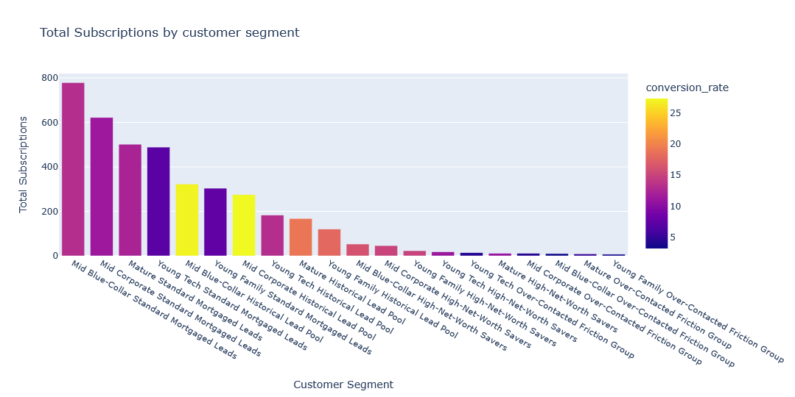
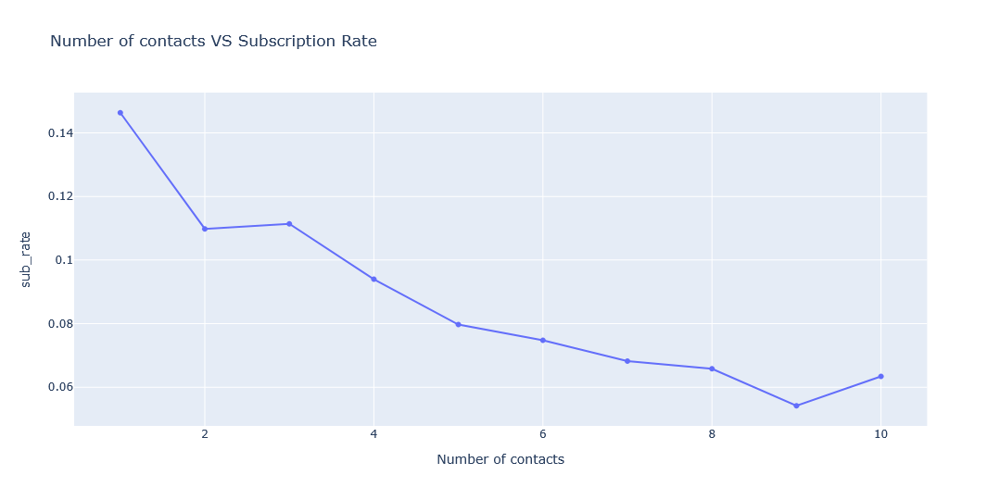

# Bank Marketing Campaign Optimization

 This project can be viewed as a slideshow on molab:
 
## Executive Summary
This project transitions a banking institution's telephone marketing strategy from a traditional mass-outreach model to a data-driven, propensity-based targeting system. By ranking leads based on their mathematical likelihood to convert, the model achieved a 78.00% subscription rate within the top 100 targeted leads, representing a significant efficiency gain over the bank's historical baseline conversion rate.

### Key Performance Metrics
| Metric | Historical Strategy | Propensity Model (Top 100) | Business Lift |
| :--- | :--- | :--- | :--- |
| **Conversion Rate** | 11.69% | 78.00% | **~6.6x** |
| **Targeting Mechanism** | Random / Mass Outreach | XGBoost predicted probabilties | N/A |
| **Primary Limitation** | High Customer Acquisition Cost | lack  of features with strong predictive signal | N/A |

---

## Need for a smarter strategy
Exploratory data analysis reveals a severe inverse relationship between operational effort and success: the bank expends maximum resources during periods of lowest customer receptivity. Furthermore, unchecked persistence actively destroys lead goodwill; Operating at an 11.69% baseline means roughly 88% of the sales team's time is wasted calling uninterested or financially constrained leads.

---

## Technical Architecture
*   **Feature Engineering (Polars):** Developed behavioral and financial indicators to provide the model with deeper context.
*   **Audience Segmentation (K-Means):** Applied unsupervised clustering to identify distinct demographic and behavioral personas, enabling the marketing team to deploy customized ad copy. And as an input to the model developed.
*   **Propensity Scoring (XGBoost):** Addressed the dataset's significant class imbalance by implementing dynamic class-weight scaling (`scale_pos_weight`). The evaluation metric was shifted from rigid binary classification thresholds to probability ranking (`predict_proba`) to prioritize high-value leads.

---

## Model Evaluation
Rather than relying on flat classification metrics on an imbalanced dataset, the model's predictive power is measured by its ability to separate high-intent buyers from low-intent leads across the entire test set. 

* **The Micro-Targeted Hit-List:** When restricting outreach strictly to the top 100 leads ranked by the model's `propensity_score`, the conversion rate hits **78.00%**, yielding a massive efficiency gain over the bank's historical **11.69%** baseline.
* **Decile 1 (The Top 10%):** The highest-ranked 10% of the entire test set converts at approximately **46%**, delivering nearly four times the historical baseline.

* **The Rejection Filter (Deciles 4 through 10):** The model successfully isolates the low-intent majority. The bottom 70% of the ranked dataset performs well below the baseline, bottoming out between **2% and 3%** in the lowest deciles.

---

## Marketing Segmentation
Different demographic and behavioral personas were identified.

---

## Maximum efficiency rules discovered
Based on exploratory data analysis and model outputs, the following constraints should be implemented to maximize sales efficiency and minimize wasted operational hours.

| Rule | Threshold / Criteria | Business Justification |
| :--- | :--- | :--- |
| **Maximum Contacts** | 3 calls per campaign | Conversion rate drops below the historical baseline after the 3rd attempt. |
| **Suppression List** | High-debt, low-balance profiles | Systematically excludes leads lacking the liquidity to purchase a term deposit. |

